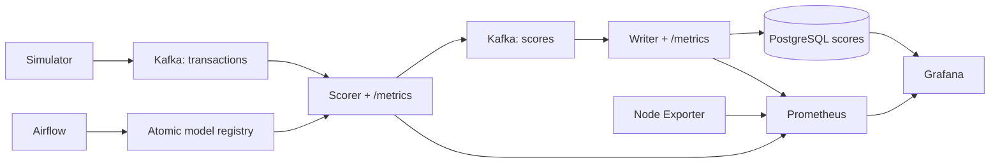

# HW4 · Наблюдаемость потокового антифрода

Продолжение HW3: Kafka → CPU-скоринг → Kafka → отдельный writer → PostgreSQL.
Prometheus собирает метрики каждую секунду; Grafana автоматически получает два
источника данных, четыре собственных дашборда и два алерта. Airflow сохраняет
поставку данных, проверку качества и переобучение. Новая модель загружается в
работающий скорер без перезапуска контейнера.

Реализованы основные и дополнительные требования задания на 8–10 баллов.
JSON дашбордов, PromQL, SQL, конфигурация сбора и правила алертов написаны для
этого проекта. Из HW3 переиспользованы обучающий pipeline, DAG и выборка данных.



## Запуск

Нужны Docker Engine/Desktop, Docker Compose v2, свободные порты 3000, 9090,
8000, 8001 и 8083. Для Docker рекомендуется 4 CPU, 8 GB RAM и 10 GB диска.
Первый запуск требует интернет для образов и Python-зависимостей.
CSV включён в репозиторий; Kaggle, токены и ручная настройка Grafana не нужны.

```bash
git clone https://github.com/gluk2003/fraud-monitoring.git
cd fraud-monitoring
docker compose up -d --build
docker compose ps -a
```

При работе из учебного каталога вместо клонирования: `cd hw4/fraud-monitoring`.
Дождитесь `healthy` у Kafka, PostgreSQL, scorer, writer и обоих сервисов Airflow.
Сервисы с суффиксом `init` штатно завершаются с кодом 0. На загрузку образов
и первый старт потребуется несколько минут, на заполнение графиков — ещё
15–30 секунд. История и модели хранятся в именованных Docker volumes.
Все сервисы находятся в одной сети `fraud-monitoring_default`.

| Что открыть | Адрес и доступ |
|---|---|
| Grafana | http://localhost:3000 — `admin` / `admin` |
| Prometheus | http://localhost:9090 |
| Состояние трёх scrape targets | http://localhost:9090/targets |
| Метрики скоринга | http://localhost:8000/metrics |
| Метрики записи | http://localhost:8001/metrics |
| Airflow | http://localhost:8083 — `admin` / `admin` |
| Алерты Grafana | http://localhost:3000/alerting/list |

При первом входе Grafana можно пропустить предложение изменить пароль.
HTTP-порты привязаны к localhost. Пароли предназначены для локального стенда.
PostgreSQL не публикует порт на хост; база результатов `fraud`, пользователь
записи `fraud` / `fraud`. Grafana использует отдельную роль `grafana_reader`
с правом только SELECT. База `airflow` на том же сервере хранит метаданные DAG.

## Дашборды

Все находятся в папке **Fraud Monitoring**, обновляются каждые 2 секунды,
начальный диапазон — последние 15 минут. При необходимости выберите
`Last 5 minutes`. SQL-панели видят данные после commit writer.

| Дашборд | Ссылка | Панели |
|---|---|---|
| 01 · Скоринг потока | http://localhost:3000/d/fraud-scoring | TPS, p50/p95 времени обработки, доля фрода за минуту, heatmap скоров, p95 возраста сообщения, активная версия, время с последней транзакции, ошибки; аннотации смены модели |
| 02 · Запись результатов | http://localhost:3000/d/fraud-writer | TPS, p95 SQL+commit, число уникальных скоров и фрода, heatmap записанных скоров, дубли, ошибки; таблица PostgreSQL с количеством скоров, долей фрода и средним скором по версии модели |
| 03 · Системные метрики | http://localhost:3000/d/fraud-system | CPU, память, входящая/исходящая сеть, занятое место и скорость чтения/записи диска |
| 04 · Бизнес и сегменты | http://localhost:3000/d/fraud-business | Фильтры `us_state` и `merch`, плотность скоров, TPS сегмента, доля фрода по `cat_id` среди последних 1000, топ продавцов по сумме подозрительных покупок, сравнение версий и размер сегмента |

В бизнес-дашборде оба фильтра поддерживают несколько значений и **All**.
Список продавцов зависит от выбранных штатов. После изменения штата выбирайте
продавца из обновлённого списка либо All. Фильтры применяются ко всем шести
SQL-панелям; в именах продавцов корректно обрабатываются апострофы через
`${merchant:sqlstring}`. Штат и продавец не включены в метки Prometheus:
подробные срезы считаются в SQL, без множества временных рядов.

Плотность — 20 интервалов шириной 0.05; высота столбца `count / (N × 0.05)`.
Суммарная площадь равна 1 при непустом сегменте. `score=1` входит в последний
интервал, пустой сегмент возвращает нули. TPS считается по фактическому
`scored_at` в интервалах 5 секунд, с заполнением пропусков нулями.

Для barplot категорий сначала выбираются **последние 1000 уникальных скоров
во всём потоке**, затем применяются фильтры штата/продавца. Временной диапазон
Grafana на эту панель не влияет. До накопления 1000 используется всё доступное
количество. Значение — среднее `fraud_flag`, а не средний score.

Собственный бизнес-график **«Топ продавцов по сумме подозрительных покупок»**
помогает выбрать, какие случаи расследовать первыми по денежному объёму.
Он учитывает выбранные фильтры и время. Сумма относится к транзакциям,
помеченным моделью; это не подтверждённый ущерб. Валюта исходной суммы не
конвертируется. Подтверждённых меток онлайн нет, precision/recall не заявляются.

Node Exporter наблюдает Linux-хост Docker: на macOS/Windows это виртуальная
машина Docker/Colima. `pid: host` и bind `/:/host:ro,rslave` обеспечивают чтение
CPU, памяти и дисков хоста. Сеть хоста читается из `/host/proc/1/net/dev`
через textfile collector (`node-exporter/start.sh`): обычный `/proc/net`
показывал бы сетевое пространство самого exporter. Сетевые панели используют
`node_host_network_*`, а exporter остаётся в общей сети Compose.

## Метрики

Гистограммы экспортируют семейства `_bucket`, `_sum`, `_count`.
Счётчики относятся к текущему процессу и сбрасываются при его перезапуске;
Prometheus `rate`/`increase` учитывают сбросы. SQL-таблица сохраняет результаты
предыдущих запусков, поэтому её итог может отличаться от счётчиков процесса.

| Метрика | Смысл / где смотреть |
|---|---|
| `fraud_scored_total` | Успешно опубликованные в Kafka результаты; TPS скоринга |
| `fraud_processing_seconds` | Признаки, inference, проверка модели и подтверждённая публикация в Kafka; p50/p95, без commit входного offset |
| `fraud_score` | Гистограмма вероятностей с шагом 0.05; heatmap скоринга |
| `fraud_flagged_total` | Число результатов с `score >= 0.5`; числитель доли фрода за минуту |
| `fraud_ratio` | Доля фрода в последних 1000 обработанных сообщениях процесса; доступна в Prometheus |
| `fraud_input_age_seconds` | **Дополнительная метрика, которой нет в семинарском скорере:** время от отправки продюсером до завершения скоринга. Панель «Возраст сообщения · p95» отличает накопление очереди от медленного inference |
| `fraud_last_success_timestamp_seconds` | Время последней обработки; панель паузы и алерт остановки потока |
| `fraud_processing_errors_total` | Ошибки обработки до retry/рестарта |
| `fraud_model_reloads_total{version}` | Число успешных горячих замен на эту версию; начальная загрузка исключена |
| `fraud_model_reload_timestamp_seconds{version}` | Время горячей замены; обеспечивает аннотацию даже для впервые появившейся серии счётчика |
| `fraud_model_active{version}` | 1 для активной, 0 для ранее загруженных версий |
| `fraud_db_written_total` | Число новых уникальных строк после PostgreSQL commit |
| `fraud_db_write_seconds` | Время INSERT + commit, включая попытки дедупликации |
| `fraud_db_flagged_total` | Число новых записанных строк с флагом фрода |
| `fraud_db_score` | Гистограмма только новых записанных скоров |
| `fraud_db_duplicates_total` | Повторные сообщения, исключённые по transaction_id |
| `fraud_db_errors_total` | Ошибки записи до retry/рестарта |
| `node_cpu_seconds_total`, `node_memory_*`, `node_host_network_*`, `node_disk_*`, `node_filesystem_*` | CPU, RAM, сеть хоста, диск; системный дашборд |
| `up` | Доступность трёх targets по метке job; `sum(up)` должно возвращать 3 |

Сервис обновляет метрики на каждом успешном сообщении. У writer счётчики и
гистограмма score обновляются после подтверждённого commit и только для новой
строки. При повторе увеличивается счётчик дублей. Результаты не теряются из-за
автоматического Kafka commit: доставка at-least-once, сначала подтверждение
выхода/БД, затем commit входного offset. При аварии возможен повтор в Kafka;
PostgreSQL удаляет повторы первичным ключом `transaction_id`.

## Проверка живого потока

Simulator каждые 0.2 секунды отправляет случайную строку из seed с новым UUID
и текущим `produced_at`; целевая метка не передаётся в Kafka. Генерация
бесконечная, это не однократный прогон файла. Исторический `transaction_time`
сохранён для совпадения признаков с обучением. Графики и фильтры времени
используют актуальный `scored_at`, возраст сообщения — `produced_at`.

Откройте обе страницы `/metrics`, найдите `fraud_scored_total` и
`fraud_db_written_total`, обновите через несколько секунд — оба значения растут.
На странице http://localhost:9090/query выполните:

```promql
rate(fraud_scored_total[15s])
rate(fraud_db_written_total[15s])
rate(fraud_flagged_total[1m]) / clamp_min(rate(fraud_scored_total[1m]), 0.001)
```

Первые два результата — около 5 транзакций/с на обычном компьютере; фактическая
скорость зависит от ресурсов. В Grafana уже должны быть графики и heatmap.
Количество строк и сохранённые версии можно проверить напрямую:

```bash
docker compose exec postgres psql -U fraud -d fraud -c \
  'SELECT model_version, count(*), avg(fraud_flag::int) AS fraud_ratio FROM scores GROUP BY model_version;'
docker compose logs --tail=30 scorer writer
```

## Переобучение и отметка версии

DAG по умолчанию на паузе: это сохраняет bootstrap для воспроизводимой
проверки. В Airflow доступны `retrain_fraud_model`, `supply_labeled_month`,
`dataset_quality`. Все имеют расписание раз в 5 минут, `catchup=False`,
`max_active_runs=1`. Для расписания снимите паузу в UI после ручной проверки.

Откройте дашборд скоринга **до** запуска переобучения. Затем выполните:

```bash
docker compose exec airflow-scheduler airflow dags test retrain_fraud_model \
  "$(date -u +%Y-%m-%dT%H:%M:%S+00:00)"
docker compose exec scorer cat /artifacts/models/latest.json
docker compose logs --tail=15 scorer
```

На чистом seed первое переобучение публикует `model-<hash>` вместо `bootstrap`.
Лог содержит `Loaded model model-... (previous=bootstrap)`. На следующей
транзакции скорер увеличивает `fraud_model_reloads_total{version="model-..."}`
и обновляет timestamp. Оранжевая аннотация с названием новой версии видна на
графиках скоринга в течение примерно 30 секунд. При расширении диапазона
историческая отметка остаётся в истории Prometheus. Панель активной модели
показывает текущую версию постоянно. Начальная загрузка не создаёт отметку
горячей замены; reload не зависит от ручного рестарта scorer.

Скорер читает атомарный `latest.json` перед каждым сообщением. Сначала
загружается весь новый бинарник, затем меняется активная модель и версия.
Публикация сначала сохраняет бинарник, затем атомарно заменяет manifest.
Кандидат и incumbent сравниваются на одном holdout по PR-AUC и ROC-AUC;
публикация возможна, только если обе метрики не хуже. Отказ quality gate
не создаёт отметку и не сдвигает окно.

Модель — sklearn Random Forest на CPU. Bootstrap учится на январе–феврале
2019, первый retrain — на феврале–марте, holdout — апрель. Обучающее окно —
три последовательных месяца. Фичи: log суммы/населения, время суток,
выходной, haversine-расстояние, one-hot категории/штата/пола. Препроцессинг
один для обучения и online; target, ID и имя продавца не входят в признаки.
Версии sklearn и dill совпадают в образах Airflow и scorer.

Для последующих окон сначала поставьте новый размеченный месяц:

```bash
docker compose exec airflow-scheduler airflow dags test supply_labeled_month \
  "$(date -u +%Y-%m-%dT%H:%M:%S+00:00)"
docker compose exec airflow-scheduler airflow dags test dataset_quality \
  "$(date -u +%Y-%m-%dT%H:%M:%S+00:00)"
```

Supply добавляет 3000 строк следующего месяца, сохраняет 36 месяцев истории
и защищает ещё нужное окно. Повтор того же run_id не вставляет дубли.
DQ проверяет схему, пропуски, дубли, даты, target, суммы, координаты,
непрерывность месяцев; HTML и JSON сравнения лежат в `/artifacts/reports`.
Их можно получить: `docker compose cp scorer:/artifacts/reports ./reports`.
Не запускайте два `dags test retrain_fraud_model` одновременно: CLI обходит
ограничение `max_active_runs`. Каждый новый logical date создаёт новый run_id.

## Алерты Grafana и воспроизведение

Правила лежат в `grafana/provisioning/alerting/rules.json`, создаются при
старте и видны в **Alerting → Alert rules → Fraud Monitoring → fraud-service**.
Вычисление каждые 10 секунд, pending 10 секунд. NoData и ошибки запроса
переводят правило в Alerting. Политика `local-status-only` заглушает доставку
уведомлений круглосуточно, сохраняя вычисление и отображение Firing в UI.

| Правило | Условие | Как вызвать |
|---|---|---|
| Fraud ratio above 20% | `sum(rate(fraud_flagged_total[1m])) / clamp_min(sum(rate(fraud_scored_total[1m])), 0.001) > 0.2` в течение 10 с | Включить high-fraud режим; ожидается Firing за 20–90 с |
| No successful scoring for 20 seconds | `time() - max(fraud_last_success_timestamp_seconds) > 20` в течение 10 с | Остановить simulator; после опустошения очереди ожидается Firing за 30–50 с |

High-fraud режим выбирает из seed **реальную транзакцию**, которой текущая
модель даёт наибольший score. Simulator повторяет её с новыми UUID. Обычный
Kafka → inference → writer продолжает работать; метрики вручную не меняются.

```bash
# 1. Включить поток с высокой долей фрода.
docker compose exec scorer python -m services.demo high-fraud
# Подождать до 90 с, проверить Firing в Grafana Alerting.

# 2. Вернуть обычную генерацию.
docker compose exec scorer python -m services.demo normal
# Подождать до 90 с: скользящее минутное окно должно очиститься.

# 3. Остановить входящий поток, проверить второй алерт.
docker compose stop simulator
# Подождать 30–50 с после обработки накопленных сообщений.
docker compose start simulator
# Через 10–20 с после возобновления правило вернётся в Normal.
```

`fraud_ratio` в последних 1000 и доля за минуту — разные окна: для алерта
используется минутная доля, чтобы быстро реагировать на изменение потока.

## Автоматические проверки

Полная сквозная проверка выполняется на **чистом стенде с bootstrap**:

```bash
python3 scripts/verify_stack.py --alerts
```

Скрипт проверяет три targets, рост обоих счётчиков, наличие всех четырёх
дашбордов и данных в каждой панели через API Grafana/Prometheus, SQL-фильтры
штата и продавца с апострофом, нормировку плотности, пустой сегмент, два
provisioned алерта, три реальных DAG Airflow, горячую замену без рестарта
scorer, 30-секундную аннотацию, новую версию в PostgreSQL и дедупликацию.
С `--alerts` дополнительно проверяет Firing обоих правил и возврат в Normal,
в блоке finally восстанавливая обычный поток. На время проверки оставьте DAG
на паузе и не запускайте ручное обучение. Отчёт: `artifacts/verification.json`
на хосте. Без флага проверка пропускает сценарии срабатывания алертов.

Модульные тесты и проверка конфигурации:

```bash
python3.11 -m venv .venv
. .venv/bin/activate
pip install -r requirements.txt pytest
pytest -q
python scripts/build_dashboards.py
docker compose config --quiet
docker compose exec airflow-scheduler airflow dags list-import-errors
docker compose exec prometheus promtool check config /etc/prometheus/prometheus.yml
```

Тесты проверяют временное окно, gate, retries, атомарную публикацию, DQ,
метрики hot reload, отказ загрузки повреждённой модели без успешного события,
скользящую долю фрода и счётчики writer без дублей. В `ci/github-actions.yml`
сохранён шаблон GitHub Actions для unit и полной интеграции с алертами на
чистом Linux-стенде. Автоматический CI не активирован: токен публикации не
имеет scope `workflow`. Для активации перенесите шаблон в
`.github/workflows/tests.yml` и отправьте его с соответствующим правом.

Результат локального сквозного прогона сохранён в
[`docs/verification.json`](docs/verification.json). Скриншоты работающего стенда:
[скоринг](docs/scoring.png), [writer](docs/writer.png),
[система](docs/system.png), [бизнес](docs/business.png),
[выбранный сегмент](docs/business-filtered.png).
Проверка браузера без ошибок JavaScript и HTTP:
[`docs/browser-verification.json`](docs/browser-verification.json).

## Структура и остановка

```text
services/stream.py                 # simulator, scoring, model hot reload
services/writer.py                 # Kafka -> PostgreSQL, idempotent commit
services/metrics.py                # bounded Prometheus metric families
services/demo.py                   # real-input alert scenarios
pipeline/, dags/                   # retraining, supply and DQ from HW3
postgres/init.sql                 # score schema, indexes, read-only Grafana role
prometheus/prometheus.yml          # three scrape jobs at 1 second
node-exporter/start.sh             # host network counters through textfile collector
grafana/dashboards/*.json          # four original dashboards
grafana/provisioning/              # two datasources, dashboard loader, two alert rules
scripts/build_dashboards.py        # reproducible dashboard/rule generation
scripts/verify_stack.py            # live integration checks
tests/                            # pipeline and monitoring unit tests
data/seed.csv                     # bundled compact learning data
```

`data/seed.csv` — 7520 строк января–апреля 2019 из набора HW3. Неиспользуемые
имена и адреса удалены. Выборка обогащена фродом; порог 0.5 и метрики нужны
для проверки механики, оценка промышленного качества модели не проводится.

Остановка с сохранением данных: `docker compose down`.
**Полный сброс только этого проекта** для повторной проверки bootstrap
удалит его Kafka/SQL/Prometheus/Grafana и модели:

```bash
docker compose down -v
docker compose up -d --build
```

При проблемах: `docker compose ps -a` и `docker compose logs --tail=100`.
Если порт занят, поменяйте только левую часть `ports` в Compose и используйте
новый адрес в браузере. Для автоматической проверки сохраняйте исходные порты.
После изменения SQL init нужен чистый PostgreSQL volume; после изменения
provisioning источников/алертов — `docker compose restart grafana`.
Дашборды перечитываются из JSON автоматически примерно за 10 секунд.

## Источники

Условие и справочная архитектура: [репозиторий семинара](https://github.com/NikitaMalykhin/mlops_realtime_fraud_detector_monitoring).
Способ provisioning: [официальная документация Grafana](https://grafana.com/docs/grafana/latest/alerting/set-up/provision-alerting-resources/file-provisioning/).
SQL-макросы и формат временных рядов: [PostgreSQL datasource](https://grafana.com/docs/grafana/latest/datasources/postgres/query-editor/).
Семинарские конфигурации Prometheus и JSON-дашборды не копировались.
